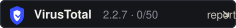

# VirusTotal

A VirusTotal report is evidence, not a badge you paste on and hope nobody checks. This page
exists so the evidence is easy to verify and easy to replace when a release is published.

**Current status:** the 2.2.6 installer exists and has a published SHA-256, but it has not been
uploaded to VirusTotal yet. The badge in the README says `no release scanned yet` on purpose; it
is not a claim of zero detections.

```
file    Oliviacode-Setup-2.2.6.exe
sha256  360b87b1006ff0f98a2360a7a1162e93d8675b7c019a4dcab83c45049daefdc1
size    257,941,745 bytes
```

[](https://www.virustotal.com/gui/home/upload)

## Verify a download yourself

Do not trust a screenshot. Hash the file you actually downloaded and compare it with the hash
published in the release notes:

```powershell
Get-FileHash .\Oliviacode-Setup-2.2.6.exe -Algorithm SHA256
```

```bash
sha256sum Oliviacode-Setup-2.2.6.exe
```

`SHA256SUMS.txt` is written next to every packaged artifact by
`packages/desktop/script/checksums.ts`, and is attached to the release together with the
installer. If the hashes differ, the file is not the file that was published.

## SmartScreen and the unsigned installer

The installer is not code-signed. SmartScreen therefore shows "Windows protected your PC" until
the download builds reputation. To run it: **More info -> Run anyway**. Before you do, check the
hash:

```powershell
(Get-FileHash .\Oliviacode-Setup-2.2.6.exe -Algorithm SHA256).Hash.ToLowerInvariant()
```

The value must match the line for `Oliviacode-Setup-2.2.6.exe` in `SHA256SUMS.txt` on the
release. A signed build replaces this section with the certificate subject.

## Filling in the report (maintainer, once per release)

1. Build the release.
2. Upload the installer to <https://www.virustotal.com/gui/home/upload>.
3. Open the finished report and copy its URL, which looks like
   `https://www.virustotal.com/gui/file/<sha256>`.
4. Save the report screenshot as `docs/security/virustotal-<version>.png`.
5. Update the badge: in `docs/security/virustotal-badge.svg`, change
   `no release scanned yet` to the version and detection count, and edit the `<a>` target in
   the README to the report URL.
6. Add the same link, the SHA-256, and the "scanned on <date>" line to the GitHub release body.

The report URL contains the SHA-256, so it can be checked against the release hash by anyone.
A screenshot alone can be edited; a hash cannot be made to match a different file.

## What the report will and will not show

- An unsigned Electron installer routinely picks up heuristic and "generic" detections from a
  handful of engines. That is expected for an unsigned build, and the report shows exactly
  which engines fired and on what.
- A report is not a warranty. It records what a set of engines said about one file at one
  moment. The SHA-256 and the source in this repository are the durable evidence.
- The engine binary is downloaded from the npm registry at build time and is covered by the
  same installer hash. Its version is pinned by `OLIVIACODE_CLI_VERSION` and recorded in
  `packages/desktop/resources/opencode-cli.version`.
